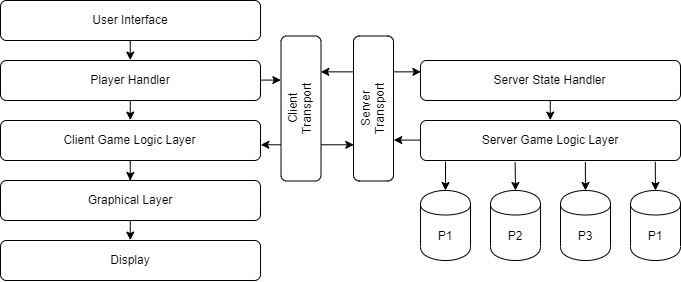

# **SHiP.io**
**_" A piece of SHiP "_**

SHiP.io is a **two-player, real-time, networked space-battle game for the Windows console**, written in C++11. Two players connect to a central server over **UDP (Winsock)**, fly ASCII spaceships around a wrapping 2D grid, collect weapon pickups, and try to shoot each other. The server relays game state between the clients and records every win in a **SQLite** leaderboard.

> Built by **Damon Hunka** for ECE 356, fall 2019.



---

## Table of contents

- [Features](#features)
- [Gameplay](#gameplay)
- [Building](#building)
- [Running](#running)
- [Architecture](#architecture)
- [Technical details](#technical-details)
- [Repository layout](#repository-layout)
- [Configuration](#configuration)
- [Known limitations](#known-limitations)
- [Roadmap](#roadmap)
- [References](#references)
- [Author](#author)
- [License](#license)

---

## Features

- Client/server multiplayer over **UDP sockets** (Winsock 2.2)
- Console renderer that only redraws when something has changed
- Main menu: start game, change avatar, credits, leaderboard, exit
- Custom single-character ship **avatars**, randomized by default
- **Weapon pickups** that spawn at random places on the grid
- Line-of-sight **laser shots** in the direction you last moved
- Persistent **top-5 leaderboard** stored in SQLite (`scores.db`)
- Play-again loop on the client; the server resets for a new match automatically
- Layered design using a singleton handler template for each driver

---

## Gameplay

The objective is to be the last ship standing.

| Key | Action |
|-----|--------|
| `W` `A` `S` `D` | Move up / left / down / right |
| `Space` | Fire a laser (uses one weapon) in the direction you last moved |
| `T` | Quit the current game |

- The arena is **40 × 25** cells, and the edges wrap around (fly off one side, come back on the other).
- Ships cannot move into the same cell as each other.
- Fly over the **pickup** to gain one weapon charge. A new pickup then spawns at a random position.
- A shot hits if the opponent is in the **same row or column, in the direction you are facing**. A hit ends the game, and the shooter's avatar gets a win in the leaderboard.
- The game starts as soon as two clients have registered with the server.

---

## Building

### Requirements

- **Windows** (the code uses Winsock, `conio.h` and `windows.h`)
- **MinGW / MinGW-w64** `gcc`/`g++` with C++11 support
- GNU `make` plus a `find`/`mkdir -p` shell, e.g. **Git Bash** or **MSYS2**

SQLite 3.30.1 is bundled as an amalgamation (`server/src/SQL/sqlite3.c`), so nothing else needs to be installed.

### Build both programs

From the repository root, run:

```bash
./SHIP.bat
```

This produces `SHIP_CLI.exe` and `SHIP_SER.exe` in the repository root.

### Build individually

```bash
cd server && make ../SHIP_SER
```

```bash
cd client && make ../SHIP_CLI
```

### Clean

```bash
cd server && make clean
```

---

## Running

1. **Set the server address.** The client currently connects to the address hard-coded in `client/src/csocket/csocket_drv.hpp`. Set `IP_ADDRESS_EFF` to the IP of the machine running the server (`ipconfig`), then rebuild the client.
2. **Start the server** from the repository root, so it can find `scores.db`:
   ```bash
   ./SHIP_SER.exe
   ```
   It opens the database, binds UDP port **9999**, and waits for two clients. Press `t` in the server window to shut it down after the current game.
3. **Start two clients**, on the same machine or on others:
   ```bash
   ./SHIP_CLI.exe
   ```
   Choose **1) Start Game** on each. The first client to register is player 1 and the second is player 2.
4. When a game ends, each client returns to the menu and the server waits for a new pair of registrations.

> Allow UDP port 9999 through Windows Firewall when playing across machines.

---

## Architecture

The system is split into layers, as shown in the diagram above. Each layer only calls the layer below it, which makes data flow easy to follow and lets each layer be tested on its own.

| Layer | Side | Implementation | Responsibility |
|-------|------|----------------|----------------|
| User Interface | Client | `Get_Input()` in `main_cli.cpp` | Polls the keyboard (`_kbhit`/`_getch`) and maps keys to `inputs_e` |
| Player Handler | Client | `main_cli.cpp` main loop | Routes input to game logic and transport |
| Client Game Logic | Client | `cGObjDrv_c` (`logic/`) | Movement, wrapping, collisions, pickups, shooting, game over |
| Client Transport | Client | `cSockDrv_c` (`csocket/`) | Registration, packing and sending player state, non-blocking receive |
| Graphical / Display | Client | `dConsoleDrv_c` (`con_display/`) | Menus, avatar selection, leaderboard, renders the grid to the console |
| Server Transport | Server | `sSockDrv_c` (`ssocket/`) | Binds port 9999, registers 2 clients, receives packets and sends them on to the other client |
| Server State Handler / Game Logic | Server | `sLogicDrv_c` (`logic/`) | Unpacks packets, keeps the authoritative copy of player state, triggers updates and game over |
| Database | Server | `dataBaseDrv_c` (`zdatabaseDrv/`) | SQLite open, select, update, top-5 queries |

Every driver is a lazily created **singleton** made with the `handler_c<T>` template in `include/project.hpp` (for example `cSockDrv_Handle::Handler_GetInstance()`).

### Client loop

```
SetupGame()  ── menu ──► Register with server ► init game state
   │
   ▼
while (!GAME_OVER):
    Draw_Game()            redraw only if input / shot / network update
    Get_Input()            non-blocking keyboard poll
    Get_ServerData()       non-blocking recvfrom → opponent state
    Calculate_GameState()  apply local input (move / shoot / exit)
    Send_Data()            send own state (or EXIT) if there was input
Game_Over()  → back to menu
```

### Server loop

```
Setup_Game():  open scores.db → register 2 clients (answer leaderboard requests meanwhile) → init state
while (!GAME_OVER):
    Update_GameState()   blocking recvfrom → sLogic_Unpack()
    Update_Clients()     forward latest state to the *other* client
```

---

## Technical details

### Networking

| Parameter | Value |
|-----------|-------|
| API | Winsock 2.2 (`WSAStartup(0x202)`) |
| Transport | UDP datagrams (`SOCK_DGRAM` / `IPPROTO_UDP`) |
| Port | `9999` |
| Packet size | Fixed 256 bytes |
| Client socket | Blocking during registration, then set to **non-blocking** (`ioctlsocket FIONBIO`) |
| Server socket | Blocking `recvfrom` on `INADDR_ANY` |

### Packet format (`clientPacket_t`)

```
┌───────────────────── cHeader_t (32 bits) ─────────────────────┐
│ type:4 │ clientID:1 │ resv:3 │ response:8 │ length:16           │
└─────────────────────────────────────────────────────────────────┘
union payload (up to 252 bytes):
  • cData_t contents[2]     – one 32-bit word per player
  • cScores_t scores[5]     – leaderboard {avatar, score}
  • uint8_t  PACKET_BYTES[256]

cData_t (32 bits):
│ state:1 │ shot:1 │ sdir:2 │ avatar:8 │ resv:4 │ x_loc:8 │ y_loc:8 │
```

| `type` | Value | Direction | Meaning |
|--------|-------|-----------|---------|
| `CLIENT_DATA` | 0 | C → S → C | Player position, shot and direction |
| `CLIENT_REG`  | 1 | C → S, S → C | Join request (avatar in `response`) / acknowledgement carrying both avatars and the assigned `clientID` |
| `CLIENT_EXIT` | 2 | C → S → C | Game over. The sender is recorded as the winner |
| `CLIENT_SCRS` | 4 | C → S → C | Leaderboard request / top-5 reply |

### Registration handshake

1. The client sends `CLIENT_REG` with its avatar character.
2. The server stores the sender's address and port as client 0, then client 1.
3. Once both have joined, the server sends each client a `CLIENT_REG` acknowledgement with its ID and both avatars.
4. The client learns its player number and the opponent's avatar, switches to non-blocking mode, and the game starts.

While waiting for registrations, the server also answers `CLIENT_SCRS` leaderboard requests from clients that are still in the menu.

### State and authority

Movement, pickups and hit detection are calculated **on the client** that made the input. The server is a lightweight relay that keeps the latest state of each player and forwards it to the opponent. A winning shot sets `GAME_OVER` on the shooter's client, which sends `CLIENT_EXIT`. The server then records the win and forwards `CLIENT_EXIT` to the other player.

### Leaderboard database

`scores.db` (SQLite 3.30.1, compiled with `SQLITE_THREADSAFE=0`) contains one table, pre-filled with one row for every printable ASCII avatar `'!'` … `'~'`:

```sql
CREATE TABLE SCORES(
    AVATAR CHAR PRIMARY KEY NOT NULL,
    SCORE  INT              NOT NULL
);
```

| Operation | Query |
|-----------|-------|
| Read score | `SELECT SCORE FROM SCORES WHERE AVATAR='<c>'` |
| Record win | `UPDATE SCORES SET SCORE=<n> WHERE AVATAR='<c>'` |
| Leaderboard | `SELECT * FROM SCORES ORDER BY SCORE DESC LIMIT 5` |

`scores_BACKUP.db` is a clean copy you can use to reset the leaderboard.

### Rendering

The console renderer clears the screen and redraws the bordered 40 × 25 grid with both avatars, the pickup and any active laser beam. A redraw only happens when there was local input, a shot is still being shown, or a network update arrived, which keeps flicker down. Lasers stay on screen for `SHOT_MAX_FRAMES` frames.

### Build system

Each side has a generic recursive makefile. It finds every `.c`, `.cpp` and `.s` file under `src/`, adds every sub-directory as an include path, builds the objects into `build/`, and links with `-lstdc++ -lws2_32`. Flags are `-std=c++11` / `-std=c11 -Wall -Wextra -g`.

---

## Repository layout

```
SHiP.io/
├── SHIP.bat                  Build script for client + server
├── ARCH.jpg                  Architecture diagram
├── scores.db                 Live leaderboard database
├── scores_BACKUP.db          Clean leaderboard backup
├── include/
│   └── project.hpp           Shared constants, packet structs, singleton template
├── client/
│   ├── makefile
│   └── src/
│       ├── main_cli.cpp      Menu + game loop
│       ├── project_cli.hpp   Client state structs and key enums
│       ├── con_display/      Console renderer and menus
│       ├── csocket/          Client UDP driver
│       └── logic/            Movement, pickups, shooting
└── server/
    ├── makefile
    └── src/
        ├── main_ser.cpp      Server session loop
        ├── project_ser.hpp   Server state structs
        ├── logic/            Packet unpacking and relaying
        ├── ssocket/          Server UDP driver
        ├── zdatabaseDrv/     SQLite leaderboard driver
        └── SQL/              SQLite 3.30.1 amalgamation
```

---

## Configuration

Compile-time constants in [include/project.hpp](include/project.hpp) and the client/server headers:

| Constant | Default | Description |
|----------|---------|-------------|
| `SIO_PORT_BINDING` | `9999` | UDP port |
| `SIO_MAX_PLAYERS` | `2` | Players per match |
| `SIO_PACKET_SIZE` | `256` | Datagram size in bytes |
| `SIO_GAME_SIZE_X` × `SIO_GAME_SIZE_Y` | `40 × 25` | Arena size |
| `SIO_P1_*START`, `SIO_P2_*START` | `(4,3)`, `(36,22)` | Spawn positions |
| `SIO_MAX_LDRBOARD` | `5` | Leaderboard entries |
| `SHOT_MAX_FRAMES` | `2` | Frames a laser stays visible |
| `IP_ADDRESS_EFF` | `IP_ADDRESS_ELW` | Server IP used by the client (`csocket_drv.hpp`) |

---

## Known limitations

- **Windows only:** uses Winsock and `conio.h`.
- **Server IP is compiled in:** the "enter IP address" prompt is a stub that waits for a key and then uses `IP_ADDRESS_EFF`.
- **The client decides hits:** hit detection and pickups are calculated on the client, so a modified client could cheat.
- **Quitting counts as a win:** pressing `T` also sends `CLIENT_EXIT`, which the server records as a win for the player who quit.
- **Pickups are not synchronized:** each client spawns its own pickup locally, so the two players see different pickup positions.
- **Fragile SQL queries:** queries are built with `sprintf`. An avatar of `'` would break the SQL statement.
- **No timeout or reconnect:** UDP has no delivery guarantees. A lost `CLIENT_EXIT` can leave one side waiting.

---

## Roadmap

- [ ] Test framework (unit and system test suites per layer)
- [ ] Replace the console renderer with OpenGL or a 2D game library (e.g. SDL)
- [ ] Runtime server IP entry with validation
- [ ] Server-authoritative hit detection and synchronized pickups
- [ ] Parameterized SQL statements (`sqlite3_prepare_v2` / `sqlite3_bind_*`)

---

## References

- Multiplayer client/server guide: <http://www.codersblock.org/blog/multiplayer-fps-part-1>
- Handmade Hero: <https://hero.handmade.network/episode/code/day001>
- SQLite C/C++ tutorial: <https://www.tutorialspoint.com/sqlite/sqlite_c_cpp.html>
- SDL (2D sprites): <https://www.libsdl.org/>
- 2D engines: [Torque 2D](http://www.garagegames.com/products/torque-2d), [Cocos2d-x](https://www.cocos.com/en/products#Cocos2d-x)

---

## Author

- **Damon Hunka** — [@DamonAknuh](https://github.com/DamonAknuh)

---

## License

SHiP.io is released under the **MIT License**. See [LICENSE](LICENSE).

The bundled SQLite amalgamation (`server/src/SQL/`) is in the **public domain**.
